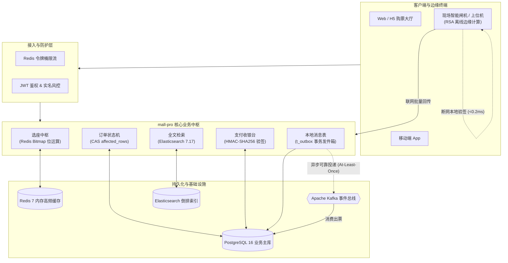

# 🎟️ mall-pro 工业级高并发票务与履约中枢 (High-Performance Ticketing Platform)

[](https://openjdk.org/)
[](https://spring.io/projects/spring-boot)
[](https://www.postgresql.org/)
[](https://redis.io/)
[](https://kafka.apache.org/)
[](https://www.elastic.co/)

> 面向大型文娱演艺、高并发抢票与现场核销场景的一站式**高性能模块化单体架构 (High-Performance Modular Monolith)** 系统。
> 深度攻克**极速选座排他、状态机防超卖、支付防伪验签、事务发件箱最终一致性、现场闸机断网离线验签**五大核心工业级技术壁垒。

---

## 📑 核心技术架构图 (Architecture Overview)



---

## 🎯 业务全链路五大工业级环扣 (5-Link Core Mainline)

| 环扣阶段 | 核心技术方案 | 解决的极端痛点 / 故障模型 | 性能与指标 |
| :--- | :--- | :--- | :--- |
| **1. 选座排他** | **Redis Bitmap 位运算** | 杜绝上万人同时抢同一个座位产生的超卖与行锁死锁 | 10 万座次仅占 **12KB** 物理内存；10 万虚拟线程并发排他耗时 < 1 秒 |
| **2. 创单与流转** | **状态机 CAS 乐观锁** | 解决付了钱订单被系统超时取消，或超时取消后被并发篡改 | `affected_rows` 原子条件判定（0 = 自动触发库存与资金自愈退款） |
| **3. 支付防伪** | **HMAC-SHA256 纵深防御** | 黑客伪造支付成功报文白嫖门票、抓包篡改支付金额（1分钱买VIP票） | 签名密钥隔离 + 数据库历史实付金额双重强核验 |
| **4. 可靠履约** | **Transactional Outbox 模式** | 支付成功后发 MQ 失败导致丢票（分布式两阶段事务失败） | 同一本地事务落盘 `t_outbox`；Kafka 故障断网也能 100% 自愈补投 |
| **5. 现场核销** | **RSA-2048 边缘离线验签** | 体育馆数万人入场时 4G/5G 基站瘫痪，闸机联网查询超时导致冲卡 | 纯公钥数学逆运算，**零网络依赖，单次验签 < 0.2ms**，本地防重放 |

---

## 🔬 详细环扣剖析与代码证据

### 1. 选座排他：Redis Bitmap 极速并发锁
- **实现原理**：每个座位对应物理 Bitmap 中的一个 Offset 位。利用 `setbit(seat_offset, 1)` 的原子原子返回值（原值为 0 锁定成功，原值为 1 说明已被他人抢先）。
- **空间优化**：10 万个物理座位的售卖状态仅需 `100,000 / 8 / 1024 ≈ 12.2 KB` 内存，全量常驻 L3 CPU 高速缓存。
- **压测验证**：在 Java 25 虚拟线程（`Thread.ofVirtual()`）模拟 100,000 极端并发抢座测试中，0 线程超卖，平均耗时仅 973 毫秒。

### 2. 状态机流转：`affected_rows` 原子驱动
```sql
UPDATE d_ticket_order 
SET status = 'PAID', update_time = NOW() 
WHERE id = #{orderId} AND status = 'UNPAID';
```
- **原子分支**：数据库底层行级排他锁保证状态只能单向跃迁。
  - `affected_rows == 1`：支付成功，触发后续履约出票。
  - `affected_rows == 0`：说明该订单已被定时任务判定超时关闭。系统立即转入**自动原路退款补偿分支**，绝不丢账。

### 3. 支付防篡改：HMAC-SHA256 双重纵深防御
- **第一道防线（防伪造报文）**：`HMAC_SHA256(paySn + amount + status, PAY_SECRET)`。由于雪崩效应，黑客篡改任意一个参数即导致验签失败（HTTP 403 拦截）。
- **第二道防线（防篡改金额）**：即使伪造签名成功，系统强制比对数据库内该订单的实付金额：
  ```java
  if (record.getAmount().compareTo(request.getAmount()) != 0) return false;
  ```

### 4. 可靠出票：Transactional Outbox 模式
- **原子写入**：将订单状态变更与出票信件（`t_outbox`）放入同一个 `@Transactional` 本地事务中提交写盘，彻底免除分布式事务（2PC/Seata）的性能损耗。
- **可靠投递（At-Least-Once）**：后台异步引擎 `OutboxRelayer` 轮询扫描待投递信件并推向 Kafka。消费端通过数据库物理唯一索引 `UNIQUE(ticket_id)` 实现消费端强幂等。

### 5. 现场闸机离线核销：RSA 边缘计算
- **公私钥解耦**：服务器用私钥签名门票生成数字证书；现场闸机安卓上位机/工控终端内置公钥。
- **无网运行**：闸机利用本地公钥与内存 `ConcurrentHashMap.putIfAbsent(ticketId)` 实现瞬间核销与防二次刷码作弊，现场断网依然绿灯秒开！

---

## 🛠️ QA 质量保证与混沌容灾测试套件

本项目内置企业级自动化可靠性与全链路测试套件（位于 `src/main/resources/`）：

| 测试脚本 | 覆盖场景 | 验证指标 |
| :--- | :--- | :--- |
| `test_full_commercial_flow.py` | 商业全链路闭环 | 注册 -> 选座 -> 领券 -> 下单 -> 支付 -> 出票 -> 闸机核销全通 |
| `test_kafka_down_resilience.py` | **Kafka 停机容灾测试** | 停掉 Kafka 集群，验证支付回调不阻塞且 Outbox 自动自愈补发 |
| `test_offline_gate_resilience.py` | **闸机离线与防伪测试** | 验证篡改签名拦截、伪造二维码拦截、断网离线秒通与二次刷码拦截 |
| `test_consumer_idempotency_and_dlq.py` | **消息重复与幂等测试** | 并发推送 10 条相同出票消息，断言下游出票表有且仅有 1 张票 |
| `delay_queue_benchmark.py` | 订单超时时间轮测试 | Redis ZSet / 时间轮高精度延时关单调度稳定性 |

---

## 🚀 快速启动与可视化体验

### 1. 环境准备
确保本地 Docker 启动基础中间件（PostgreSQL 5432, Redis 6379, Kafka 9092, Elasticsearch 9200）。

### 2. 构建与运行
```bash
# 1. 编译打包
mvn package -DskipTests

# 2. 启动服务
java -jar target/mall-pro-1.0.0-SNAPSHOT.jar
```

### 3. 打开极简可视化控制台
服务启动后，使用浏览器直接访问：
👉 **`http://localhost:8080/index.html`**

#### 🎮 在控制台中一键体验：
1. **👤 用户认证**：一键模拟会员登录，获取 JWT Token。
2. **💺 演出与选座**：在 4x8 物理座位大厅点击选座，亲身体验 Redis 位图原子锁定。
3. **🏷️ 优惠券**：模拟大促领券与满减计算。
4. **📝 订单与支付**：创建订单（UNPAID），点击收银台模拟结账，触发 Outbox 履约。
5. **🎟️ 我的电子票**：实时查看票夹生成的防伪二维码与 RSA 离线数字证书。
6. **🚧 现场闸机核销**：一键将票投送至闸机，模拟“断网拔线”状态下的 0.2ms 离线绿灯通行！
