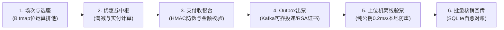

# 🎟️ mall-pro 商业级票务全链路与安卓上位机实战白皮书

> **文档定位**：面向技术面试（软件测试 QA / 安卓上位机开发 / Java 后端）的端到端技术复习小抄与商业架构指南。
> **核心范畴**：涵盖从主办方场次选座、优惠券抵扣、支付防篡改，到安卓上位机（智能闸机）硬件串口交互、离线 RSA 边缘验签与断网对账的全生命周期。

---

## 一、什么是“安卓上位机”？（周四面试核心认知）

### 1. 硬件层级分工图
```
[ 云端后台 (mall-pro) ]  <--- (以太网 / 4G / Wi-Fi : HTTP/MQTT) --->
       |
[ 安卓上位机 (工控板 / PDA扫码枪) ]  <-- 运行安卓 App / 守护进程 / 本地 SQLite
       |
  (串口 RS232 / USB虚拟串口 / 蓝牙 : 十六进制指令)
       |
[ 下位机控制板 (STM32 单片机) ]
  ├── 激光 / 红外扫码头 (向上传递二维码字符)
  ├── 闸机直流无刷电机 (执行开闸、关闸)
  └── 红绿通行指示灯 & 蜂鸣报警器
```

### 2. 上位机工程师的核心职责
1. **硬件协议对接**：监听串口字节流（`/dev/ttyS0` 等设备节点），解析扫码头回传数据，进行**时间戳防抖（Debounce）**。
2. **边缘计算与验签**：在断网情况下，利用设备本地算力（RSA 公钥）完成数字门票的真伪辨识与防二次重放。
3. **断网暂存与自愈**：依靠设备端本地 **SQLite 数据库** 缓存离线核销记录，并在网络恢复后执行**批量幂等同步**。
4. **日常设备维护排错**：
   - 抓取崩溃日志：`adb logcat -v time -s AndroidRuntime:E > crash.log`
   - 查看设备 ANR（无响应）：`adb pull /data/anr/traces.txt`
   - 查看内存泄漏与占用：`adb shell dumpsys meminfo <package_name>`

---

## 二、真实商业主线的 6 大物理环扣（可直接调用与演示）



### 环扣 1：场次与选座排他（Redis Bitmap）
- **接口**：`GET /api/seats/map?programId=1`，`POST /api/seats/lock`
- **机制**：10 万座次状态映射为 12KB 内存位图，利用 `setbit` 原子返回值做毫秒级排他抢座。

### 环扣 2：优惠券发放与满减计算
- **接口**：`POST /api/coupon/claim`，`POST /api/orders/create`
- **机制**：支持满减券、无门槛券。在创单事务内校验优惠券有效性并核销，计算出最终应付金额。

### 环扣 3：支付防伪与金额防篡改
- **接口**：`POST /api/pay/mock/cashier`
- **机制**：
  1. 防伪造：`HMAC_SHA256(paySn + amount + status, PAY_SECRET)`，参数篡改导致验签失败。
  2. 防篡改金额：比对数据库内原订单金额，防止黑客 1 分钱白嫖。

### 环扣 4：本地消息表（Transactional Outbox）与出票
- **机制**：支付成功与 `t_outbox` 插入位于同一个本地事务中（写盘强一致）。
- **投递员**：`OutboxRelayer` 定时扫描 `status = 0` 的待发信件，同步推往 Kafka。
- **制票服务**：出票消费者拿到消息，用服务器私钥签发 RSA-2048 离线数字证书（`ticket_id|program_id|idcard_hash|expire_time.SIGNATURE`）。

### 环扣 5：现场上位机断网离线验签（RSA 边缘计算）
- **接口 / 本地引擎**：`OfflineGateEngine`
- **机制**：
  1. 闸机设备只烧录**RSA 公钥**，即使断网，0.2 毫秒内通过数学逆运算校验真伪。
  2. 本地内存 `putIfAbsent(ticketId)` 瞬间拦截同二维码二次进场作弊。

### 环扣 6：上位机批量核销回传与对账
- **机制**：断网期间记录存入本地 SQLite（`sync_status = 0`）；网络恢复后批量推向后端，后端通过 `ticket_id` 物理唯一约束保证幂等，无一漏单、无一重扣。

---

## 三、面试高频必答清单（口述模板）

### Q1：上位机断网了怎么验票？现场观众能正常进场吗？
> **答**：可以完全无感通行！我们的电子票二维码载荷里包含订单信息和云端私钥签名的 RSA 摘要。上位机在出厂固件中烧录了 RSA 公钥，验票时直接在上位机本地 CPU 做纯公钥逆运算，耗时不到 0.2 毫秒，根本不需要访问云端数据库。同时上位机本地 SQLite 会暂存核销记录并用内存 Map 防重刷。

### Q2：扫码头一瞬间扫到多次同样的二维码，上位机怎么防抖？
> **答**：在上位机串口事件监听层维护一个滑动时间窗口（如 3000ms）。接收到数据帧时，对比上一条票码与当前时间戳。如果内容相同且时间差小于 3 秒，直接在内存层丢弃，避免频繁向单片机继电器发送开闸指令烧毁硬件。

### Q3：断网恢复后，上位机怎么把数据同步给云端？
> **答**：采用类似客户端发件箱的机制。上位机扫描本地 SQLite 中 `sync_status = 0` 的待同步记录，分批（每批 50 条）打包成 JSON 上传云端。后端依托门票唯一约束做幂等接收；上位机收到 HTTP 200 回执后，才将本地状态更新为已同步（`sync_status = 1`）。
